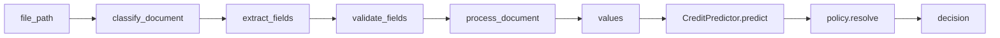

# ML-модуль

## Назначение
ML-модуль покрывает 4 задачи:
1. OCR/document extraction
2. Validation of extracted fields
3. Credit scoring
4. Policy decisioning


## Тесты
Запуск:
```
pytest tests/ml/ -v
```

## Структура файлов
- app/ml/documents
- app/ml/scoring
- tests/ml

# Архитектура



## Контракты
- process_document(input: file_path, application_data, document_type_hint=None) -> dict
- CreditPredictor.predict(values) -> dict
- policy.resolve(score_result, request, product, thresholds) -> dict

# Предположения

Синтетические данные. Упрощённая аннуитетная схема. Реальная калибровка отсутствует.OCR необязателен, возможен ручной ввод.


# Контракты данных

process_document принимает file_path, application_data, document_type_hint; возвращает dict. CreditPredictor.predict принимает values; возвращает dict. policy.resolve принимает score_result, request, product, thresholds; возвращает dict. Версионирование через VERSION.


# Метрики

Измеряются accuracy, F1, уверенность OCR. Целевые значения TBD. Результаты после тестов.


# Настройка моделей

Установить tesseract-ocr-rus. Веса rus.traineddata. Источники/лицензии Apache-2.0.


# OCR-пайплайн

Открытый исходный код Tesseract, лицензия Apache-2.0. Предобработка: grayscale/denoise. Извлечение полей: метка -> значение. Проверка контрольных сумм ИНН/ОГРН. Автокоррекция. Порог уверенности 0.80. Ограничения: нет поддержки таблиц и рукописного текста.


# Объяснение политики

Правила приоритета: hard stops, missing data, approve, modified, info, reject. Пороги 76/64/50. counter_offer по доступности (affordability). Ценообразование: key_rate + spread + surcharge.


# Объяснение скоринга

Score = sum w_k * f_k(x_k) * 100. 
Веса факторов: credit_history 0.25, debt_burden 0.20, financial_capacity 0.20, business_age 0.10, registry_tax 0.10, product_fit 0.10, data_quality 0.05. 
Hard stops: bankruptcy, inactive, overdue>90. 

